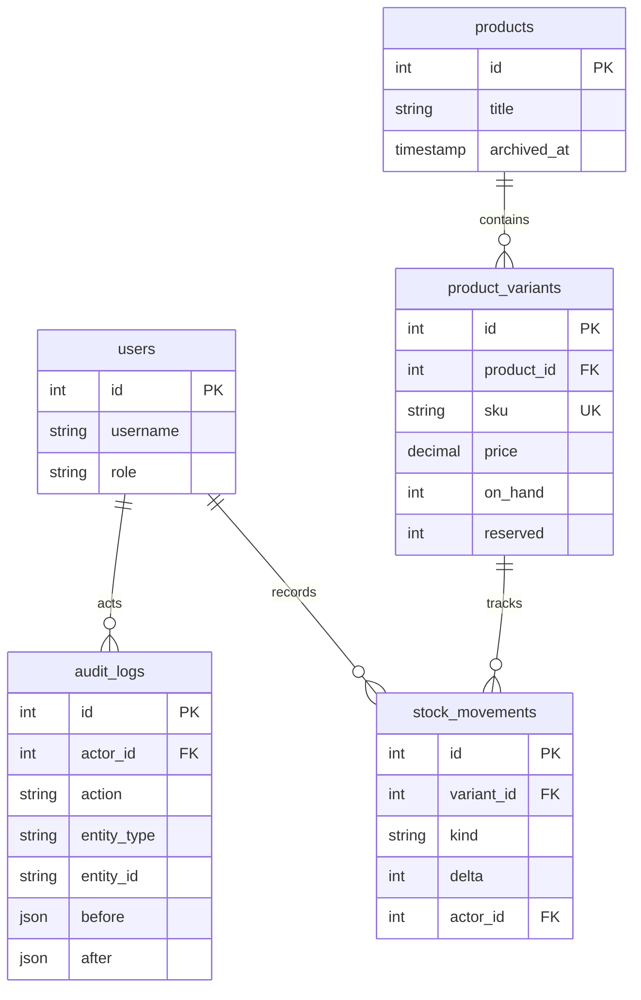

# Catalog and inventory: one store

This project extends a backend technical test into a stock workflow. An admin creates products and SKU variants, staff record movements, and viewers inspect balances. PostgreSQL keeps the ledger, counters and audit in the same transaction.

## Data model

Products retain the technical test's numeric price response. Variant prices use decimal strings with exactly two fractional digits. SKU uniqueness lives in PostgreSQL; normalization trims whitespace and converts letters to uppercase before insertion.

## Transaction choices

Stock writes lock the product before its variant. Archive follows the same order and locks all variants by ascending ID. This makes stock changes and archive serialize: an archived product cannot receive stock, and a product with stock cannot be archived. Counter updates, ledger insertion and audit insertion either all commit or all roll back.

Role changes use a transaction advisory lock before counting admins. Tokens do not carry the authority to change roles: each request loads the current role from PostgreSQL. Public signup creates viewers; an explicit local CLI creates the first admin. The final admin cannot be demoted.

The ledger offers no update or delete endpoint. Corrections use signed ADJUSTMENT entries with a reason. Authorized users can inspect historical movements even after the product is archived; active balance listings exclude archived products.

## Evidence collected locally

- Role and first-admin tests: five cases passed, including simultaneous demotions and an existing token observing its changed role.
- Audit tests: two cases passed, including forced database insertion failure and catalog rollback.
- Variant tests: three cases passed, including simultaneous duplicate SKUs and direct database constraint checks.
- Inventory tests: five cases passed, including the last-unit race, integer overflow, forced ledger/audit failures and archive racing against movement.
- Swagger UI upgrade: UI, CSS, JavaScript and OpenAPI passed compatibility checks; production dependency audit reported zero vulnerabilities after the approved upgrade.

These are local results. The committed CI workflow still needs an authorized push and an actual Actions run. No production deployment or throughput benchmark is claimed.

On 2026-10-05, `npm test -- --runInBand` passed 9 suites/13 cases; `npm run test:integration -- --runInBand` passed 15 suites/32 cases and built successfully first. Migration tests covered an empty database, repeated migration, hash mismatch and an upgrade from M1 preserving its product and backfilling users as viewers. A separate `product_management_demo` database on the isolated test PostgreSQL also passed real HTTP checks for two SKUs with ten units each, viewer mutation 403 and admin audit 200.

## Demo and limits

Use the HTTP collection alongside Swagger. Demo seed is explicit, accepts only `product_management_demo` or `product_management_test`, refuses production mode, and does not duplicate opening movements on replay. All demo names and credentials are synthetic.

The model has one store, one location and IDR prices. Catalog cache is in-memory for one API instance; inventory is read from PostgreSQL. A user has one active refresh session; logout revokes refresh tokens while existing access tokens remain valid until expiry. Frontend, public hosting and CSV import are separate work.
