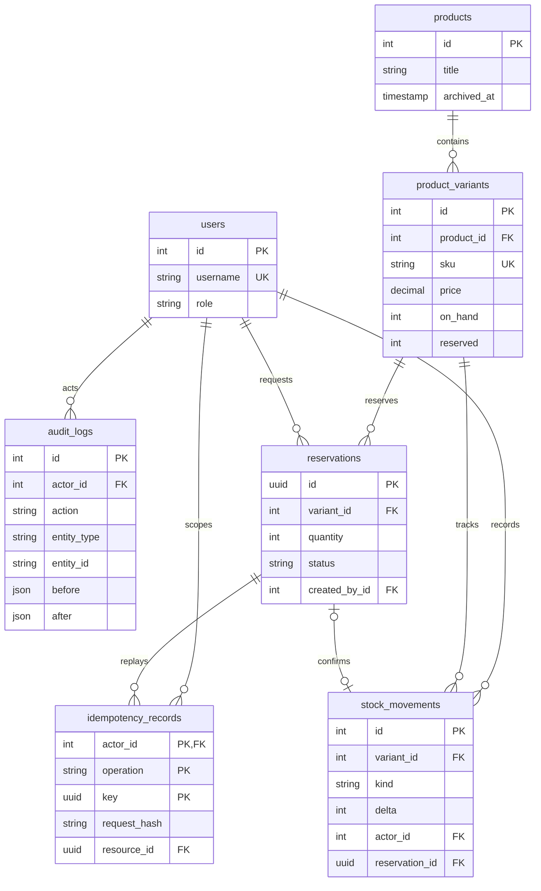
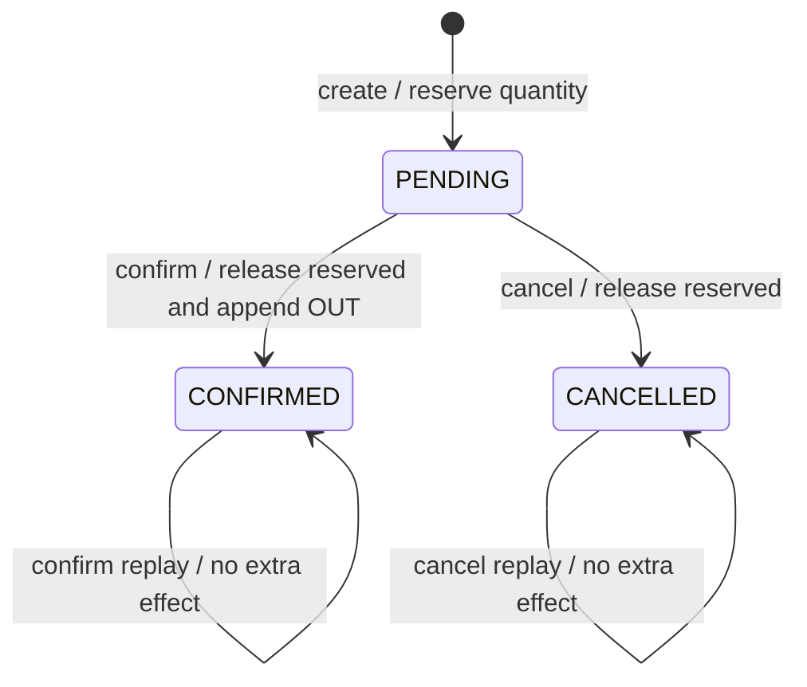

# Catalog and inventory: one store

This project extends a backend technical test into a stock workflow. An admin creates products and SKU variants, staff record movements, and viewers inspect balances. PostgreSQL keeps the ledger, counters and audit in the same transaction.

## Data model

Products retain the technical test's numeric price response. Variant prices use decimal strings with exactly two fractional digits. SKU uniqueness lives in PostgreSQL; normalization trims whitespace and converts letters to uppercase before insertion.

## Transaction choices

Stock writes lock the product before its variant. Archive follows the same order and locks all variants by ascending ID. This makes stock changes and archive serialize: an archived product cannot receive stock, and a product with stock cannot be archived. Counter updates, ledger insertion and audit insertion either all commit or all roll back.

Role changes use a transaction advisory lock before counting admins. Tokens do not carry the authority to change roles: each request loads the current role from PostgreSQL. Public signup creates viewers; an explicit local CLI creates the first admin. The final admin cannot be demoted.

The ledger offers no update or delete endpoint. Corrections use signed ADJUSTMENT entries with a reason. Authorized users can inspect historical movements even after the product is archived; active balance listings exclude archived products.

## Reservation workflow

Idempotency is scoped to actor, operation and a normalized UUID key. Creation locks that scope before the product and variant, hashes the validated `{variant_id, quantity}` payload in fixed property order, and commits the resource, reserved counter, audit and key record together. An identical retry returns the same resource in its current state with 201. A conflicting payload returns 409. Different actors may use the same key independently.

Terminal transitions lock product, variant, then reservation. Confirm releases reserved before applying OUT within the same transaction. A partial unique index permits only one reservation OUT. Repeated terminal calls keep the original state and ledger; an opposite terminal call returns 409. There is no automatic expiry, payment or multi-SKU cart.

To reproduce the last-unit race, run `npm run test:integration -- --runInBand test/reservations-acceptance.e2e-spec.ts`. The test creates one opening unit, launches two real HTTP requests from different actors and keys, then checks retry, double confirm, balances, ledger and audit. A separate case cancels and verifies that another actor can reserve the released unit. The test harness disables throttling for this transaction suite so 429 cannot mask a database result.

## Verification results

On 2026-10-06, the resumed M3 build passed. Unit verification passed 10 suites/16 cases; serial HTTP integration verification passed 18 suites/44 cases. This includes fresh migrations and upgrades from both M1 and M2, retaining existing catalog and stock ledger data. Jest required execution outside the Windows sandbox because its Temp directory was inaccessible; integration was invoked directly with `node --experimental-vm-modules node_modules/jest/bin/jest.js --config ./test/jest-e2e.json --runInBand` to preserve serial execution.

The separate demo database was upgraded to M3 without a reset. Real HTTP requests produced `[201,409]` for the last-unit reservation race, 201 for creation replay, `[200,200]` for two simultaneous confirms, one confirmation OUT, two reservation audit entries and final counters `{on_hand:0,reserved:0,available:0}`. A separate cancellation allowed another actor to reserve the released unit. The synthetic race SKU was left empty after explicit cleanup movements; the original seeded SKU balances were retained.

- Role and first-admin tests: five cases passed, including simultaneous demotions and an existing token observing its changed role.
- Audit tests: two cases passed, including forced database insertion failure and catalog rollback.
- Variant tests: three cases passed, including simultaneous duplicate SKUs and direct database constraint checks.
- Inventory tests: five cases passed, including the last-unit race, integer overflow, forced ledger/audit failures and archive racing against movement.
- Swagger UI upgrade: UI, CSS, JavaScript and OpenAPI passed compatibility checks; production dependency audit reported zero vulnerabilities after the approved upgrade.

These are local results. The committed CI workflow still needs an authorized push and an actual Actions run. No production deployment or throughput benchmark is claimed.

On 2026-10-05, `npm test -- --runInBand` passed 9 suites/13 cases; `npm run test:integration -- --runInBand` passed 15 suites/32 cases and built successfully first. Migration tests covered an empty database, repeated migration, hash mismatch and an upgrade from M1 preserving its product and backfilling users as viewers. A separate `product_management_demo` database on the isolated test PostgreSQL also passed real HTTP checks for two SKUs with ten units each, viewer mutation 403 and admin audit 200.

## Demo and limits

The M2 review found and reproduced a database URL override bypass in the test/seed guard. Protected URLs now reject query parameters, and the connected database name is checked before destructive operations. Review fixes also reject null required fields, whitespace-only catalog labels, non-scalar prices and out-of-range IDs/pages. Swagger logout declares Bearer security. Regression verification passed 10 unit suites/16 cases and all 15 M2 integration suites/32 cases.

Use the HTTP collection alongside Swagger. Demo seed is explicit, accepts only `product_management_demo` or `product_management_test`, refuses production mode, and does not duplicate opening movements on replay. All demo names and credentials are synthetic.

The model has one store, one location and IDR prices. Catalog cache is in-memory for one API instance; inventory is read from PostgreSQL. A user has one active refresh session; logout revokes refresh tokens while existing access tokens remain valid until expiry. Frontend, public hosting and CSV import are separate work.
